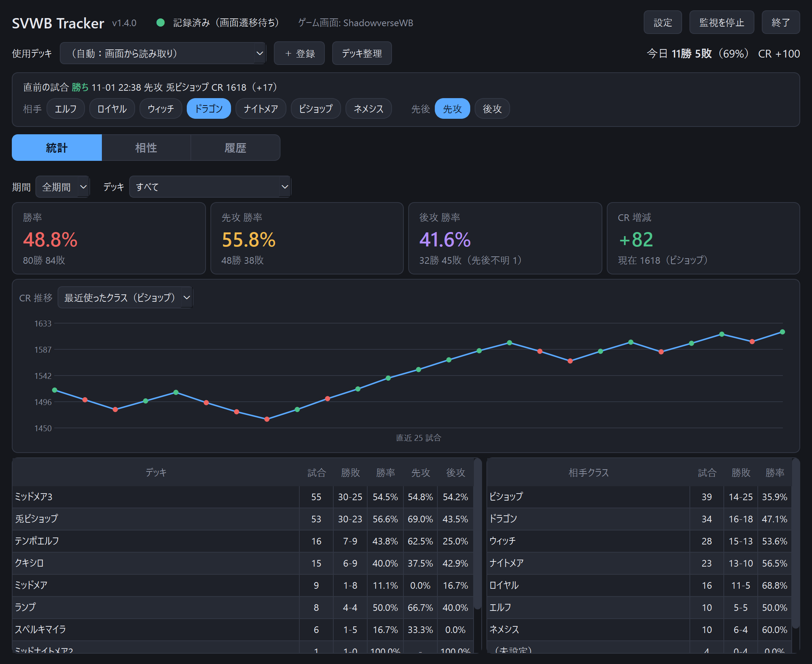
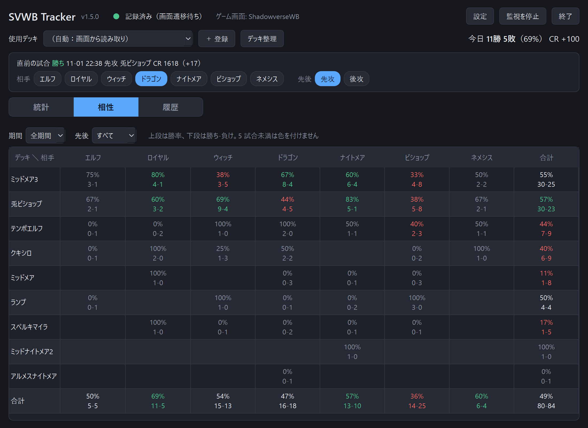
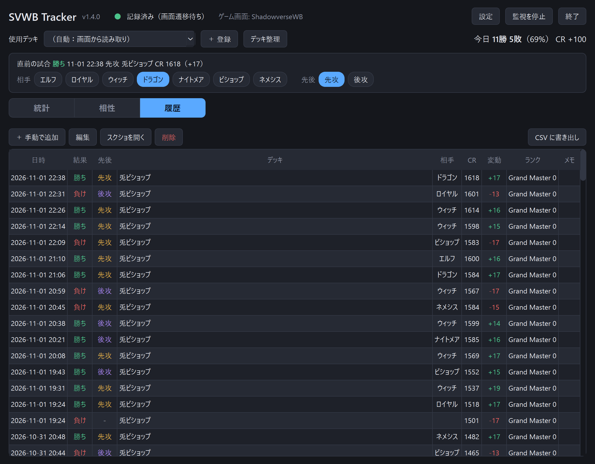
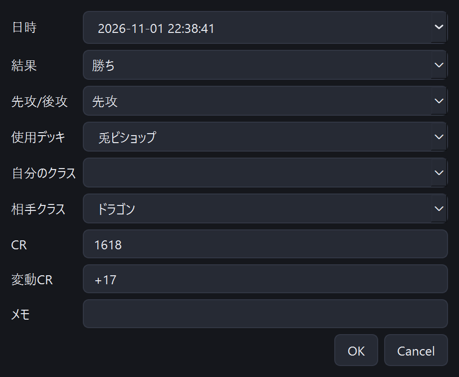
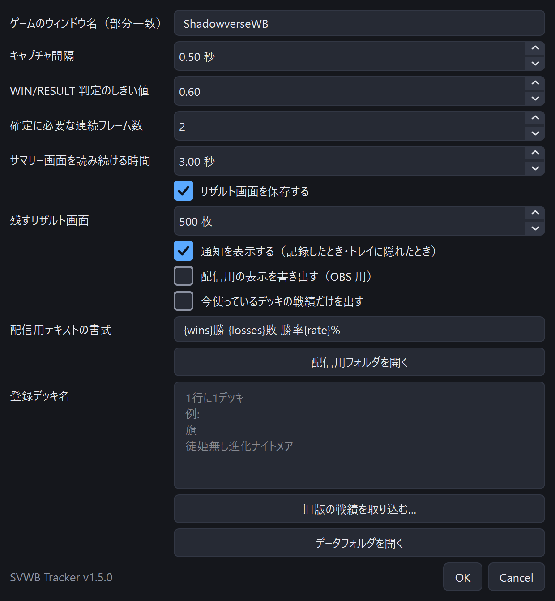
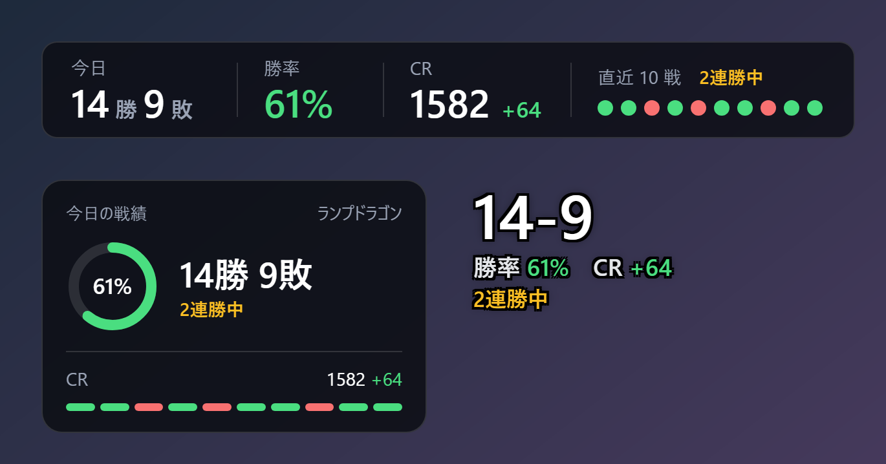
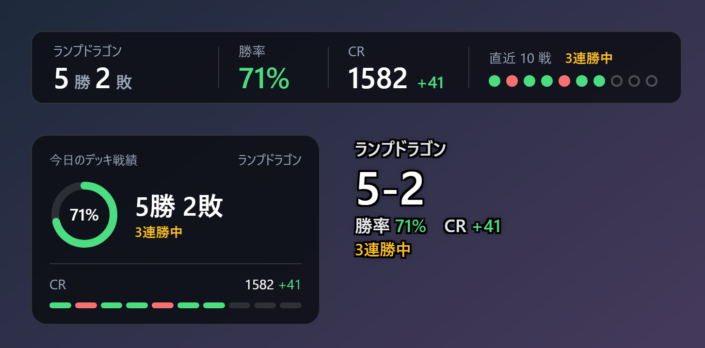

# SVWB Tracker

Steam 版 Shadowverse: Worlds Beyond のランクマッチの戦績を、自動で記録する Windows 用のツールです。\
ゲームの画面を読み取って記録するだけで、ゲームの操作やデータの書き換えは一切しません。\
非公式のファンメイドツールです。



| 相性タブ | 履歴タブ |
|---|---|
|  |  |

| 記録の編集 | 設定 |
|---|---|
|  |  |

配信用の表示（OBS のブラウザソース）



## 使う人向け

### ダウンロード

[Releases のページ](https://github.com/yukkesaba/svwb-tracker/releases) から `SVWB-Tracker-（バージョン）.zip` をダウンロードします。

### 動作環境

- Windows 10 / 11（64bit）
- Windows の「日本語」言語パック（日本語版 Windows なら最初から入っています）
  - 文字の読み取りに Windows 標準の OCR を使います
- ゲームの画面比率が 16:9（1920x1080、2560x1440 など）

### 起動のしかた

1. zip を好きな場所に展開します（「Program Files」以外がおすすめです）
2. 展開した「SVWB Tracker」フォルダの中の `SVWB Tracker.exe` を起動します
   - 初回は「Windows によって PC が保護されました」と出ることがあります。\
     「詳細情報」→「実行」で起動できます（署名していないため出る表示です）
3. 起動すると自動で監視を始めます。あとはゲームでランクマッチを遊ぶだけです

すでに起動しているときにもう一度起動すると、新しくは起動せず、動いているほうのウィンドウが出ます。

### 自動で記録されるもの

試合ごとに次の項目を記録します。

- 勝敗
- 先攻・後攻
- 相手クラス
- 使用デッキ
- ランク
- 獲得MP
- CR と変動CR

記録の日時は試合開始の時刻です。\

先攻・後攻と相手クラスは、対戦開始時の VS 画面から読みます。\
対戦の途中でツールを起動したときなど、VS 画面を見られなかった試合では空になります。\
空のときは、画面上部の「直前の試合」にあるボタンを押すと1クリックで直せます。

### 主な機能

#### 統計タブ

期間（今日・7日間・30日間・全期間）とデッキで絞り込んで、次の内容を見られます。

- 勝率、先攻の勝率、後攻の勝率、CR の増減
- CR の推移のグラフ
- デッキごと、相手クラスごとの成績

「今日」は朝5時で区切ります。

#### 相性タブ

自分のデッキと相手クラスの組み合わせごとの勝率を表で見られます。\
期間と先攻・後攻で絞り込めます。\
5試合未満の組み合わせは色を付けません。

#### 履歴タブ

記録した試合の一覧です。次の操作ができます。

- 編集（行をダブルクリックしても開きます）
- 削除（元に戻せません）
- 手動で追加
- その試合のリザルト画面のスクリーンショットを開く
- CSV に書き出し

#### デッキ名の登録と「デッキ整理」

デッキ名は画面から読み取りますが、まれに読み間違えます。\
「＋ 登録」でデッキ名を登録しておくと、読み崩れても登録した名前に揃えて記録します。\
読み間違えが強いとそのまま記録されてしまいますので、その場合は手動で修正をお願いします。


デッキ名が増えてきたら「デッキ整理」で整理できます。

- 名前の変更と、複数のデッキの統合（変更の前にデータの控えを自動で作ります）
- 使わなくなったデッキを隠すことも出来ます。隠したデッキは選択肢と読み取りの候補から外れますが、戦績と統計には残ります。\
  隠したデッキをまた使うと、自動で表示に戻ります

#### 通知

試合を記録したときと、ウィンドウがトレイに隠れたときに、Windows の通知を出します。\
「設定」の「通知を表示する」でオフにできます。

#### 配信用の表示（OBS など）

「設定」の「配信用の表示を書き出す」をオンにすると、今日の戦績を `data\obs` フォルダに書き出します。\
試合のたびに自動で表示が変わります。「設定」の「配信用フォルダを開く」でフォルダを開けます。

**デザインした表示（OBS の「ブラウザ」ソース）**

3 種類あります。背景は透明なので、ゲーム画面の上にそのまま重ねられます。\
どれか1つでも、複数を同時に置いてもかまいません。


| ファイル | 中身 | 大きさの目安 |
|---|---|---|
| `bar.html` | 帯。今日の勝敗・勝率・CR・直近10戦 | 幅 700 × 高さ 100 |
| `card.html` | カード。勝率のリング・連勝・デッキ名 | 幅 320 × 高さ 220 |
| `minimal.html` | 背景なしの縁取り文字だけ | 幅 320 × 高さ 160 |

1. OBS の「ソース」の「＋」から「ブラウザ」を追加する
2. 「ローカルファイル」にチェックを入れ、`data\obs` の中の上のファイルを選ぶ
3. 幅と高さを上の目安にする

もしくはhtmlファイルをOBSのプレビュー画面にドラッグアンドドロップしても追加出来ます。\
ソースから幅と高さを設定してください。

- 直近10戦は、まだ試合がない分を空の丸で並べます。試合数が少なくても帯の幅は変わりません
- Master 帯では CR が出ないので、CR の欄は自動で隠れます
- 試合が記録されると、勝敗の数字が少し跳ねます

**今使っているデッキの戦績だけを出す**

「設定」の「今使っているデッキの戦績だけを出す」をオンにすると、勝敗・勝率・連勝・直近10戦・CR の増減を、\
直前の試合のデッキで今日戦った分だけで数えます。

- デッキを替えて1試合すると、記録のときにそのデッキの数字へ切り替わります
- 前のデッキに戻すと、そのデッキの今日の続きから数えます
- 表示にはデッキ名が出ます（帯は左上、カードは右上、ミニマルは数字の上）
- CR の値そのものはデッキに関係なく今の CR です
- テキストソース用の `today.txt` も同じくデッキごとの数字になります
- 設定を切り替えると、試合を待たずにすぐ表示が変わります



色や大きさは、同じ画面の「カスタム CSS」で変えられます。使える名前は各 HTML ファイルの先頭に書いてあります。

```css
:root { --win: #22c55e; --loss: #ef4444; }  /* 勝ち・負けの色 */
:root { --size: 64px; }                     /* minimal.html の文字の大きさ */
```

**文字だけの表示（OBS の「テキスト」ソース）**

テキストソースで「ファイルから読み取り」に `data\obs\today.txt` を指定します。\
書式は「配信用テキストの書式」で変えられます（初期値は `{wins}勝 {losses}敗 勝率{rate}%`）。\
使える名前は次のとおりです。書式の欄にマウスを乗せても出ます。

| 名前 | 内容 |
|---|---|
| `{wins}` | 勝ち数 |
| `{losses}` | 負け数 |
| `{total}` | 試合数 |
| `{rate}` | 勝率 |
| `{streak}` | 連勝・連敗 |
| `{cr}` | 現在の CR |
| `{cr_net}` | CR の増減 |
| `{deck}` | 直前の試合のデッキ |
| `\n` | 改行 |

#### リザルト画面のスクリーンショット

記録した試合のリザルト画面を `data\screenshots` に保存します。\
新しい順に 500 枚まで残し、それより古いものは自動で消します（戦績は消えません）。\
枚数は「設定」の「残すリザルト画面」で変えられます（0 で無制限）。\
保存そのものは「リザルト画面を保存する」でオフにできます。

#### トレイと「終了」ボタン

監視中にウィンドウを閉じると、タスクトレイに隠れて記録を続けます。\
トレイのアイコンをクリックするとウィンドウが戻ります。右クリックのメニューからも「表示」「監視の開始・停止」「終了」ができます。\
監視を止めているときにウィンドウを閉じると、そのまま終了します。

ツールを終わらせるときは、ウィンドウ右上の「終了」ボタンか、トレイのメニューの「終了」を使います。\
対戦中に終了すると、その試合は正しく記録されません。

### データの場所

戦績・設定・スクリーンショット・ログは、`SVWB Tracker.exe` と同じフォルダの `data` フォルダに入っています。\
「設定」の「データフォルダを開く」でも開けます。

| ファイル・フォルダ | 中身 |
|---|---|
| `matches.db` | 戦績 |
| `settings.json` | 設定 |
| `screenshots\` | リザルト画面のスクリーンショット |
| `obs\` | 配信用の表示（オンにしたときだけ） |
| `tracker.log` | ログ |
| `debug\` | 読み取りに失敗した画面（最大20枚） |
| `matches.backup_（日時）.db` | デッキ整理で名前を変えたときに作る控え |

### バックアップと新しい版への移行

バックアップは、ツールを終了してから `data` フォルダをまるごと別の場所にコピーします。

新しい版に更新するときは、新しい版の zip を別のフォルダに展開し、古い版の `data` フォルダを新しい版のフォルダ（`SVWB Tracker.exe` と同じ場所）にコピーします。

### アンインストール

フォルダごと削除してください。\
戦績を残したいときは、先に `data` フォルダをコピーしておいてください。

### できないこと・注意

- ゲームのウィンドウが最小化されているときや、ほかのウィンドウで隠れているときは読み取れません\
  （画面に映っている内容をそのまま読むためです）
- PC のロック中など、画面を取得できない間は記録できません
- ウィンドウモードでも記録できます。ただしゲームの画面が 1920x1080 より小さいと、デッキ名とランクを読み間違えやすくなります\
  （勝敗・先攻後攻・相手クラス・CR・獲得MP は 960x540 まで縮めても読めます）
- デッキ名はまれに読み間違えます。登録しておくと揃いやすくなります。間違えた記録は履歴タブで直せます
- 対戦の途中で起動したときなどは、先攻・後攻と相手クラスが空になります

### うまく記録されないとき

報告のときは、次のものを添えてもらえると原因を調べられます。

- ウィンドウ左上に出ているバージョン（v1.1.0 など）
- `data\tracker.log`
- `data\debug` の画像

### 更新履歴

- **v1.3.2**: ウィンドウが小さいとき、MP内訳画面の「Masterレベル」の帯をデッキ名として拾うことがあったのを直しました
- **v1.3.1**: v1.3.0 で起動できなかった不具合を直しました
- **v1.3.0**: 配信用の表示を、今使っているデッキの戦績だけで出せるようにしました。直近10戦の丸は試合が少なくても10個分並べ、帯の幅が変わらないようにしました
- **v1.2.0**: 配信用の表示に、OBS のブラウザソースで使うデザインした表示（帯・カード・ミニマル）を足しました
- **v1.1.1**: 相手がエルフのときにクラスを読めないことがあったのを直しました。獲得MP が空になる・10倍で記録されることがあったのを直しました
- **v1.1.0**: GitHub での公開を始めた版です

## 開発者向け

### ソースから動かす

Python 3.10 で開発しています。

```
py -3.10 -m venv .venv
.venv\Scripts\pip install -r requirements.txt
.venv\Scripts\python app.py
```

`python app.py --no-start` で、監視を止めた状態で起動します。

ソースから動かすと、データはリポジトリ直下の `data\` に入ります（exe 版は exe と同じフォルダの `data\`）。\
Windows の「日本語」言語パックが必要です（OCR に使用）。

### 仕組み

| 項目 | 取り方 |
|---|---|
| 勝敗 | 画面上部の WIN / RESULT をテンプレートマッチング |
| CR・変動CR・獲得MP・ランク・フォーマット | リザルト画面右側を Windows OCR |
| 使用デッキ | 「使用デッキ」の名前を OCR → 過去に使ったデッキ名・登録したデッキ名に寄せる |
| 先攻・後攻 | VS 画面の自分側（左）のバッジをテンプレートマッチング。左右のバッジが逆になっているときだけ採用 |
| 相手クラス | VS 画面右側のクラス名を OCR |

変動CRが読めなかったときは、前回の CR との差から計算します。

```
capture.py        ウィンドウの描画領域を撮影して 1920x1080 に揃える
screens.py        WIN / RESULT のタイトル文字と VS 画面のバッジを判定
tracker.py        待機 → 2フレーム連続で確定 → 数秒かけて数値を読む → 記録 → 画面が変わるまで待つ
result_reader.py  OCR の結果から CR やデッキ名を拾う
worker.py         キャプチャと判定を別スレッドで回す
db.py             SQLite（data/matches.db）
obs.py            配信用の出力（today.txt と、assets/overlay の HTML に渡す data.js）
gui/              PySide6 の画面
```

### テスト

```
.venv\Scripts\python tests\test_tracker.py
```

テストで使うゲーム画面のスクリーンショット（`tests/fixtures`）は公開していません。\
無い場合、スクリーンショットを使うテストは自動で飛ばされます。

保存済みのスクリーンショットで判定と読み取りの精度を測るには `tools/eval_screens.py` を使います。

```
.venv\Scripts\python tools\eval_screens.py <スクショのフォルダ> [旧版の matches.db]
```

2026-09 時点（旧版が保存したスクショ 約300枚）: 勝敗判定 247/247、旧版がロビーを誤って「勝ち」にしていた 54 枚はすべて除外、CR 41/41 一致。

### ビルドと配布

ビルドには PyInstaller が必要です（`requirements.txt` には入っていません）。

```
.venv\Scripts\pip install pyinstaller
```

- `build.bat`: exe をビルドして `app\` に置きます（`app\data` の戦績・設定は消しません）
- `SVWB Tracker.bat`: `app\SVWB Tracker.exe` を起動します
- `package.bat`: `app\` から配布用の zip を `release\SVWB-Tracker-（バージョン）.zip` に作ります。\
  `data` は入れず、`配布用\はじめにお読みください.txt`・`LICENSE`・`配布用\licenses` を入れます
- バージョン番号は `svwb/__init__.py` の `__version__` です

### そのほかのツール

- `tools/make_screenshots.py`: この README のスクリーンショット（`docs/screenshots/`）を撮ります。\
  自分の戦績を読み取り専用で開き、一時フォルダに写して日時をずらしてから描きます
- `tools/make_overlay_shots.py`: 配信用の表示のスクリーンショット（`6_overlay.png`, `7_overlay_deck.png`）を、\
  見本の数字で Chrome（なければ Edge）のヘッドレスを使って撮ります
- `tools/merge_data.py`: 別のフォルダで使っていた `data` を `app\data` に取り込みます
- `tools/make_icon.py`: アプリのアイコンを描きます

## 権利について

- このツールのソースコードは MIT ライセンスです（[LICENSE](LICENSE)）。ゲーム由来の画像は対象外です。
- 非公式のファンメイドツールです。株式会社Cygames とは関係ありません。
- 「Shadowverse」およびゲーム内の画像・名称の権利は株式会社Cygames に帰属します。\
  `assets/templates` の画像は、画面の判定に必要な文字部分だけを切り出したものです。
- テストで使うゲーム画面のスクリーンショット（`tests/fixtures`）は公開していません。\
  無い場合、スクリーンショットを使うテストは自動で飛ばされます。
